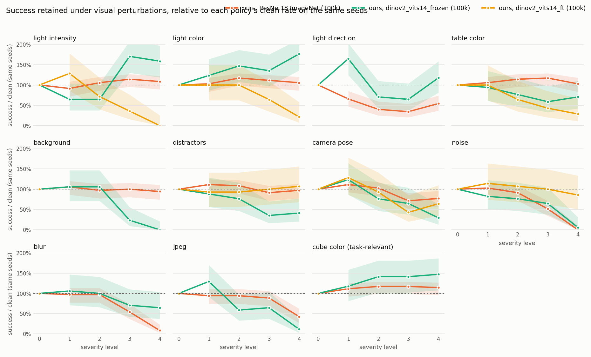
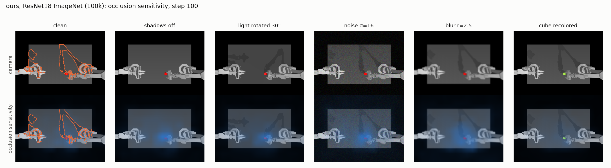
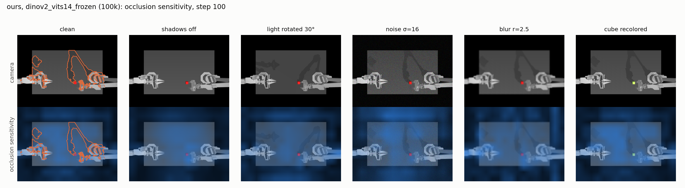
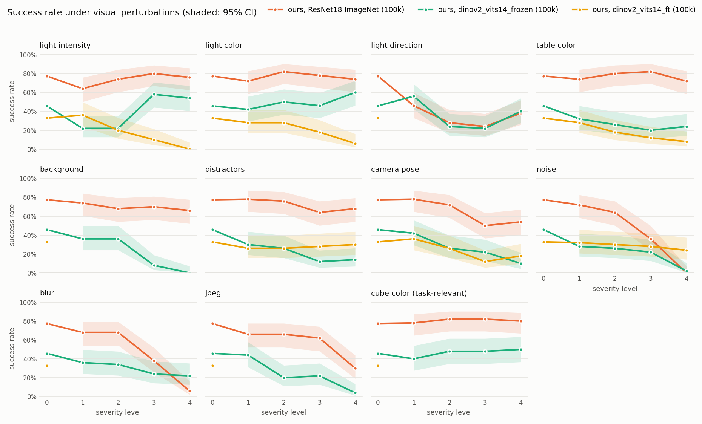
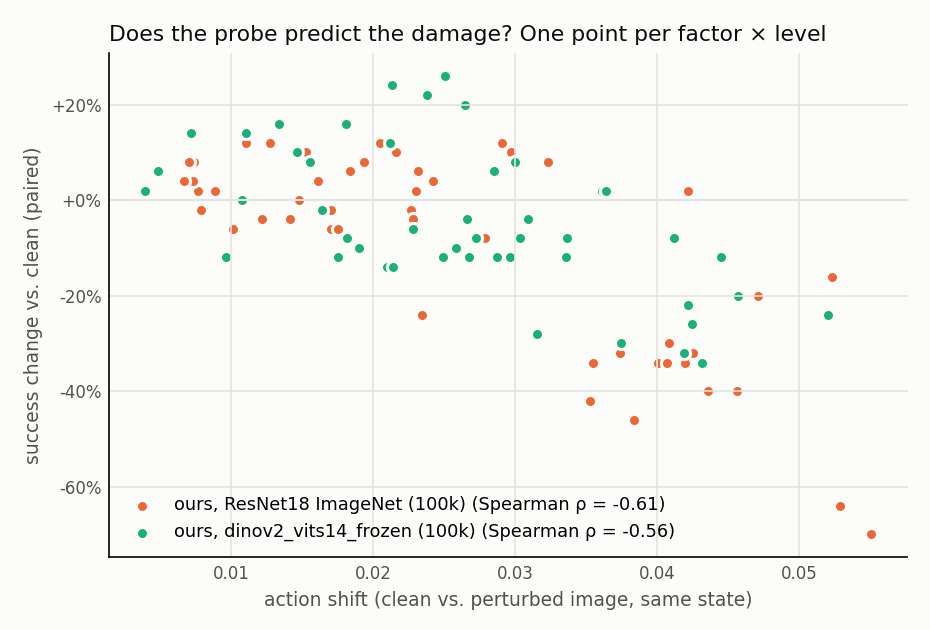
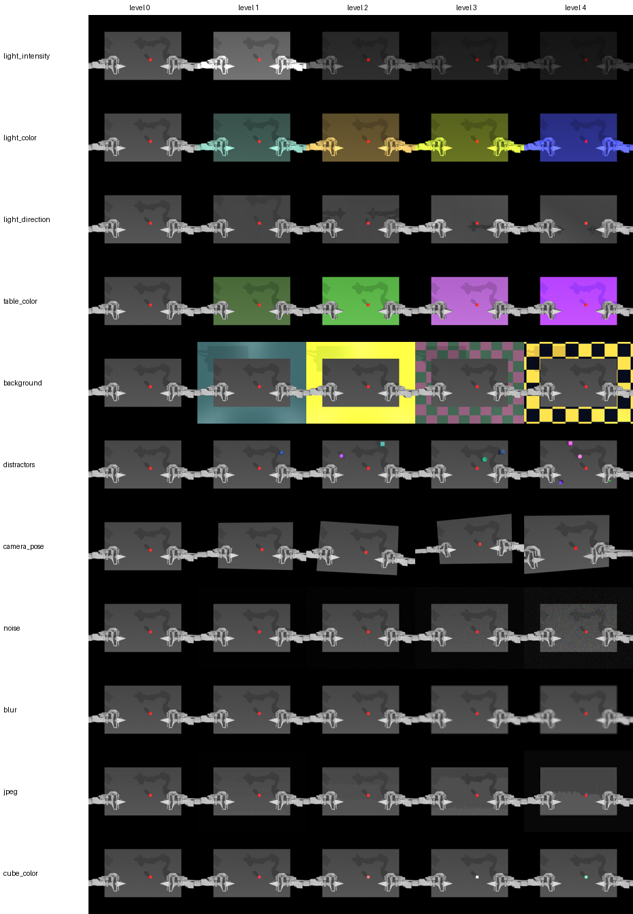

# How Robust Are Visuomotor Imitation Policies to Visual Shift?

Self-study final project following Stanford
[CS231n: Deep Learning for Computer Vision](https://cs231n.stanford.edu/) (Spring 2026 curriculum).

Imitation-learning policies like [ACT](https://tonyzhaozh.github.io/aloha/) see the world only through a camera. This
project trains ACT policies with different visual encoders on the ALOHA *transfer cube* task in simulation, breaks them
with purely visual perturbations, and works out **what each policy actually relies on**.

## Key findings

1. **The baseline reads shadows.** The ImageNet-ResNet18 ACT ignores lighting color, table color, background and even
   the cube's color, but switching shadows off halves its success (70 → 36 %, paired p = 0.003). A pre-registered
   diagnostic shows the light-direction failure is explained by the shadows: from a top-down camera they are the only
   height cue.
2. **Every encoder fails differently.** With the same recipe, frozen DINOv2 is pulled towards distractor objects and
   backgrounds (up to 76 % of episodes never touch the cube) but is relatively robust to blur; finetuned DINOv2 is
   nearly immune to noise and distractors, collapses under brightness and color changes (0 % at light intensity
   level 4), and does *not* use shadows. Neither matches the ResNet in clean performance (46 % / 33 % vs. 77 %).
3. **Representation shift is not damage.** A new background moves the ResNet's features more than any other
   perturbation and barely changes its actions; distractors move frozen DINOv2's features little and flip its decision.
4. **A 10-minute probe predicts a new policy's weak spots.** Replaying clean actions under each perturbation (states stay
   identical, only pixels change) and measuring the shift of the predicted action chunk ranks the closed-loop damage.
   Pre-registered on finetuned DINOv2 before running its suite: Spearman ρ = −0.72 (p = 7e-5).



| Policy (100k steps, seed 1000) | Clean success (500 ep.) | Never finds the cube | Breaks under | Robust to |
|---|---|---|---|---|
| Reference checkpoint (LeRobot Hub) | 83.4 % | 1.6 % | – | – |
| **Baseline:** ACT, ImageNet ResNet18, finetuned | 77.4 % | 1.2 % | shadows / light direction, strong noise, blur, JPEG | color, background, distractors |
| ACT, DINOv2 ViT-S/14, frozen | 45.8 % | 20.2 % | distractors, background, camera pose, shadows | blur, color, lighting |
| ACT, DINOv2 ViT-S/14, finetuned | 32.8 % | 35.2 % | brightness, light / table color, camera pose | noise, distractors, shadows |
| ACT, DINOv2 ViT-S/14 at 2× resolution, frozen | *training* | | | |

<table>
<tr>
<td></td>
</tr>
<tr>
<td></td>
</tr>
</table>

*Occlusion sensitivity (how much the predicted action chunk changes when a gray patch hides each location; orange =
shadows) for the same state under six conditions. The ResNet baseline (top) focuses on the cube and the approaching
gripper; frozen DINOv2 (bottom) depends on the whole table and background.*

## Setup

| | |
|---|---|
| Task | `gym_aloha/AlohaTransferCube-v0`: the right arm picks up a cube and hands it to the left arm; one top-down 640 × 480 camera |
| Policy | [LeRobot](https://github.com/huggingface/lerobot) ACT (0.6.1), trained on the 50 human demos of `lerobot/aloha_sim_transfer_cube_human` with the reference recipe: batch 8, lr 1e-5, 100k steps, no augmentation |
| Encoders | swapped through a LeRobot plugin, everything else in ACT unchanged ([details](#encoder-variants)) |
| Perturbations | 11 visual factors × 4 severity levels, physics bit-identical to the clean scene ([details](#perturbation-suite)) |
| Evaluation | clean: 500 episodes (seeds 1000–1499); suite: 50 episodes per cell (seeds 1000–1049). Every comparison is **paired on the same seeds** (exact McNemar test, Holm correction over cells) |
| Compute | Google Colab Free, one T4: 7.6–12.7 h per 100k-step run, ~3 h per suite, ~10 min per probe |

## Plan

| Step | Goal | Status |
|---|---|---|
| 1 · Baseline | Reproduce ACT on `AlohaTransferCube-v0` (pretrained checkpoint + own training) | ✅ |
| 2 · Analysis | Perturbation suite + shadow diagnostics ✅; encoders: DINOv2 frozen ✅, finetuned ✅, 2× resolution 🚧, ResNet18 from scratch / CLIP / SigLIP ⏳; replay probe + occlusion maps ✅ | 🚧 |
| 3 · Method | Targeted modification derived from the analysis (e.g. shadow-randomized training) | ⏳ |

## Detailed results

### Step 1b · Pretrained checkpoint reproduces the reference

`lerobot/act_aloha_sim_transfer_cube_human` on `AlohaTransferCube-v0`, 500 episodes (env seeds 1000–1499),
LeRobot 0.6.1 / MuJoCo 3.8.1 (checkpoint migrated to the processor format).

| | Success rate | 95% CI |
|---|---|---|
| Model card (LeRobot) | 83.0 % | – |
| **This repo** | **83.4 %** (417/500) | 79.9 – 86.4 % |

Where the 83 failures stop (highest reward stage reached):

| Stage | Meaning | Episodes |
|---|---|---|
| 0 | never touched the cube | 8 (1.6 %) |
| 1 | touched, but not lifted (grasp failure) | 29 (5.8 %) |
| 2 | lifted, but never reached the left gripper (transport / handover failure) | 46 (9.2 %) |
| 3 | left gripper touches while cube still on table | 0 |
| 4 | **successful transfer** | 417 (83.4 %) |

More than half of the failures happen after a successful grasp, during the transport to the other arm.

### Step 1c · Training ACT ourselves with the reference recipe

Same recipe as the reference checkpoint's `train_config.json` (batch 8, lr 1e-5, seed 1000, no augmentation,
ImageNet ResNet18), trained on Colab Free (T4, 0.275 s/step), evaluated on the same 500 seeds:

| | Success | 95% CI | never touched | grasp failure | transport failure |
|---|---|---|---|---|---|
| Reference checkpoint | 83.4 % | 79.9 – 86.4 % | 1.6 % | 5.8 % | 9.2 % |
| Ours, 80k steps | 72.8 % | 68.7 – 76.5 % | 1.2 % | 9.0 % | 17.0 % |
| **Ours, 100k steps** | **77.4 %** | 73.5 – 80.8 % | 1.2 % | 8.8 % | 12.6 % |

The model card says 80k steps, but the reference's `train_config.json` says 100k; the extra 20k steps mostly
fixed transport failures. A paired test on the same episodes (exact McNemar) still finds a gap:
the reference alone succeeds in 68 episodes, ours alone in 38 (p = 0.005). With a single training seed we
cannot tell training-seed variance from LeRobot / dataset-format version effects (the only other config
difference is the video decoder, `pyav` vs `torchcodec`). **Our 100k run is the baseline for all encoder
comparisons**, which use exactly this recipe and the same evaluation seeds.

### Step 2b · Where the baseline breaks: the policy reads shadows

Our 100k baseline under the perturbation suite, 50 episodes per cell (seeds 1000–1049). Every cell is compared
**paired** with the clean run on the same seeds (on these seeds the clean success rate is 70 %, not 77 %), exact
McNemar test, Holm-corrected over all 49 cells.

| Perturbation | Level | Success | Δ vs. clean (same seeds) | p (Holm) |
|---|---|---|---|---|
| `light_direction` (15° / 30° / 45° / 60°) | 1 / 2 / 3 / 4 | 46 / 28 / 24 / 38 % | −24 / **−42** / **−46** / −32 | 1 / **0.009** / **0.009** / 0.2 |
| `noise` σ = 16 / 32 | 3 / 4 | 36 / 0 % | −34 / **−70** | 0.06 / **3e-9** |
| `blur` radius 2.5 / 3.5 px | 3 / 4 | 38 / 6 % | **−32** / **−64** | **0.02** / **2e-7** |
| `jpeg` quality 5 | 4 | 30 % | **−40** | **0.015** |
| `camera_pose` 7–10 cm, 6–8° | 3 / 4 | 50 / 54 % | −20 / −16 | 1 / 1 |
| light intensity / color, table color, background, distractors, **cube color** | 1–4 | 64–82 % | −6 … +12 | 1 |

* **Color does not matter, not even the cube's.** A green or white cube is transferred as often as the red one: the policy
  does not find the cube by its color.
* **Light *direction* does, color and brightness don't.** What changes with the direction are the shadows. A pre-registered
  follow-up with two diagnostic factors isolates them (same seeds, same per-episode light rotation):

  | Condition | Success |
  |---|---|
  | clean | 70 % |
  | shadows switched off, lights unchanged | **36 %** (paired p = 0.003) |
  | light rotated 15° → 60°, shadows on | 46 / 28 / 24 / 38 % |
  | same rotation, shadows off | 36 / 36 / 30 / 40 % |

  Removing the shadows alone halves the success rate; once they are gone, rotating the light barely matters any more;
  and moved shadows are as bad as missing ones (p = 0.36–1 per level). The `light_direction` failure is explained by the
  shadows. Our reading: from a camera looking straight down, height is hard to see, and the policy has learned to use the
  shadows of grippers and cube as a height cue.
* **High-frequency corruptions** (strong noise, blur, JPEG) break the ImageNet ResNet18 encoder, a known weakness of
  supervised CNN features (ImageNet-C). Blur mostly breaks the handover (60 % transport failures at level 4), noise
  already the approach (42 % never touch the cube).

### Step 2c · Frozen DINOv2: worse overall, distracted by objects, still reads shadows

Same recipe (100k steps, seed 1000), only the encoder changed: frozen DINOv2 ViT-S/14 at 224 × 294 instead of the
finetuned ImageNet ResNet18 at 480 × 640.

| 500 clean episodes | Success | never touched | grasp failure | transport failure |
|---|---|---|---|---|
| Baseline (ResNet18, finetuned) | 77.4 % | 1.2 % | 8.8 % | 12.6 % |
| DINOv2 ViT-S/14, frozen | **45.8 %** | **20.2 %** | 12.0 % | 22.0 % |

Paired on the same 500 seeds the baseline alone succeeds in 195 episodes, DINOv2 alone in 37 (p = 4e-27). One in five
DINOv2 episodes never finds the cube. A likely reason (not yet tested): at the ViT's input resolution the ~20 px cube
shrinks to ~9 px, less than one 14 px patch, and a frozen encoder cannot learn to represent it more precisely. So this
comparison mixes *frozen vs. finetuned* with *low vs. full resolution*.

Under the suite (paired, 50 episodes per cell; clean on these seeds: baseline 70 %, DINOv2 34 %), what each policy
**retains** relative to its own clean rate:

| Perturbation | Baseline | DINOv2 frozen |
|---|---|---|
| blur, level 4 | 6 % (retains 9 %) | 22 % (retains **65 %**) |
| noise, level 3 | 36 % (51 %) | 22 % (65 %) |
| background, level 3 / 4 | 70 / 66 % (~97 %) | **8 / 0 %** (24 / 0 %) |
| distractors, level 3 / 4 | 64 / 68 % (~94 %) | **12 / 14 %** (~38 %) |
| camera pose, level 4 | 54 % (77 %) | 10 % (29 %) |
| light intensity / color, cube color | ≈ clean | ≈ clean |
| shadows off | 36 % (51 %) | **6 %** (18 %) |

* **Frozen DINOv2 is pulled towards other objects and patterns.** With distractors or a checkerboard background,
  52–76 % of its episodes never touch the cube (baseline 0–6 %): it heads for the wrong target. DINOv2's features are
  known to highlight salient objects in general; the finetuned ResNet has learned to ignore everything but the cube.
* **It is relatively more robust to blur** (and somewhat to moderate noise), in line with the literature on
  self-supervised ViT features. At the strongest noise / JPEG levels both collapse.
* **It relies on shadows just as much:** shadows off drops it from 34 % to 6 % (p = 0.003); with the light rotated 15°,
  56 % succeed with shadows and 22 % without (p = 0.0009). With two very different encoders relying on shadows, we first
  read this as a property of the task and the top-down camera (the only height cue in the image). **Finetuned DINOv2
  (below) does not rely on shadows, so this reading was wrong:** whether a policy uses the shadow cue depends on the
  learned representation, not only on the task.

After Holm correction over 49 cells only background / noise / JPEG at level 4 are significant for DINOv2 (its low clean
rate limits power); the distractor effect is consistent across all four levels.

### Step 2c · Finetuning DINOv2 makes it worse

The obvious next test: if freezing was the problem, finetuning DINOv2 (same 224 × 294 input, same recipe, encoder
learning rate 1e-5 as for the ResNet) should close the gap. It does the opposite:

| 500 clean episodes | Success | never touched | grasp failure | transport failure | final train loss |
|---|---|---|---|---|---|
| Baseline (ResNet18, finetuned) | 77.4 % | 1.2 % | 8.8 % | 12.6 % | ~0.05 |
| DINOv2 ViT-S/14, frozen | 45.8 % | 20.2 % | 12.0 % | 22.0 % | ~0.06 |
| DINOv2 ViT-S/14, **finetuned** | **32.8 %** | **35.2 %** | 9.6 % | 22.4 % | **~0.045** |

Paired: the baseline alone succeeds in 253 episodes, finetuned DINOv2 alone in 30 (p = 4e-45). The finetuned ViT fits
the 50 demonstrations best (lowest training loss) and generalizes worst: consistent with overfitting / distorting the
pretrained features on a tiny dataset (cf. Kumar et al., 2022, *Fine-Tuning can Distort Pretrained Features*), which the
ResNet with frozen BatchNorm and convolutional inductive bias resists. It also means freezing was not DINOv2's main
problem. Next: `dinov2_vits14_hr`, the same frozen DINOv2 at 448 × 588 input with 2 × 2 token pooling, so ACT gets the
same 16 × 21 tokens and **only the resolution** changes (the ~20 px cube then spans more than one patch).

#### Pre-registered prediction: finetuning swapped *what* DINOv2 is sensitive to

*Written before running the perturbation suite on finetuned DINOv2, from the probe alone (git history has the timestamp).*

Mean action shift over levels 1–4 (rad):

| Perturbation | Baseline | DINOv2 frozen | DINOv2 finetuned |
|---|---|---|---|
| light intensity | 0.018 | 0.019 | **0.063** (level 4: **0.101**) |
| light color | 0.016 | 0.020 | **0.038** (level 4: 0.083) |
| table color | 0.017 | 0.020 | **0.037** |
| camera pose | 0.044 | 0.042 | **0.066** |
| distractors | 0.015 | 0.037 | **0.009** |
| noise | 0.029 | 0.031 | **0.007** |
| JPEG | 0.026 | 0.025 | **0.011** |

Finetuning made DINOv2 nearly invariant to noise, JPEG and distractors, and very sensitive to global photometric
changes and the camera pose, which never vary across the 50 demonstrations: it appears to have latched onto fixed image
statistics. Its action shift at light intensity level 4 is almost twice the largest the baseline ever showed (noise
level 4, 0.055, where the baseline dropped to 0 %). **Prediction for the suite**, relative to its own clean rate on the
same seeds: finetuned DINOv2 collapses under light intensity (levels 3–4), light color (level 4), table color and
camera pose, where the baseline barely moved, and stays near its clean rate under noise, JPEG and distractors.

#### Outcome: the probe predicted the new policy's weak spots

Targeted suite on finetuned DINOv2 (6 factors + shadow diagnostics, 50 episodes per cell; clean on these seeds 28 %).
Success retained relative to that clean rate, levels 1 → 4:

| Perturbation | Finetuned DINOv2 | Predicted | |
|---|---|---|---|
| light intensity | 129 / 71 / 36 / **0 %** (level 4: p_Holm = 0.004, 94 % never touch the cube) | collapse at 3–4 | ✅ |
| light color | 100 / 100 / 64 / 21 % | collapse at 4 | ✅ direction (n.s. after Holm) |
| table color | 100 / 64 / 43 / 29 % | collapse | ✅ graded |
| camera pose | 129 / 93 / 43 / 64 % | collapse | ✅ partly; the baseline also loses here (71 / 77 %), so "baseline barely moved" was wrong |
| noise | 114 / 107 / 100 / **86 %** (baseline: 51 / 0 % at levels 3 / 4) | robust | ✅ |
| distractors | 93 / 93 / 100 / 107 % (frozen DINOv2: ~38 % at 3–4) | robust | ✅ |

Over these 24 cells the probe's action shift, measured *before* the suite, ranks the suite's paired success change with
Spearman ρ = −0.72 (p = 7e-5), better than on the two policies the probe was developed on (−0.61, −0.56). The cheap
replay probe (~10 min) is a usable predictor of a new policy's robustness profile; with a 28 % clean rate only light
intensity level 4 survives Holm correction on its own, so the per-cell evidence is weak but the pattern is consistent.

**Not predicted:** finetuned DINOv2 does **not** rely on shadows (shadows off: 30 % vs. 28 % clean; rotated light
without shadows: 79–107 %), unlike the baseline (70 → 36 %) and frozen DINOv2 (34 → 6 %). The probe's moderate shadow
action shift (0.028) had hinted at less dependence, but not at none. Together with the photometric sensitivity, it looks
like finetuning traded the geometric shadow cue for absolute brightness / color statistics, which happen to be constant
in the training data.

### Step 2d · What moves the representation vs. what moves the decision

Because every perturbation is visual-only, a clean episode's actions can be replayed under any perturbation: the robot
passes through exactly the same states, only the image differs. At 8 probe steps per episode (10 seeds) we compare the
policy's internals on the clean vs. perturbed image of the *same* state: **feature shift** (cosine distance of the
encoder's feature maps) and **action shift** (mean |Δ| of the predicted 100-step action chunk, rad). This takes ~10 min
per policy instead of ~3 h for the closed-loop suite, and still ranks the damage: Spearman ρ between action shift and
the paired success change over all factor × level cells is −0.61 (ResNet18) and −0.56 (frozen DINOv2).

Mean over levels 1–4:

| Perturbation | ResNet18 (finetuned): feature → action shift | DINOv2 (frozen): feature → action shift |
|---|---|---|
| background | **0.38** → 0.011 | 0.26 → **0.040** |
| distractors | 0.07 → 0.015 | **0.03** → **0.037** |
| blur | 0.18 → 0.032 | **0.03** → 0.015 |
| noise | 0.23 → 0.029 | 0.21 → 0.031 |
| shadows off | 0.14 → 0.040 | 0.11 → 0.032 |

* **How far the features move says little about the damage.** For the finetuned ResNet a new background moves the
  features more than any other perturbation, yet barely changes the decision: the policy has learned to ignore it.
  Frozen DINOv2's decision moves 3.5× more for the same background, matching its collapse in the suite.
* **Distractors change few tokens but flip DINOv2's decision:** its mean feature shift is *smaller* than the ResNet's,
  its action shift 2.5× larger. This is the probe-side view of "heads for the wrong object". It also explains why the
  feature shift predicts DINOv2's damage worse (ρ = −0.42) than its action shift does (−0.56).
* **DINOv2's blur robustness sits in the representation itself:** its features barely move under blur.
* **Shadows:** "rotated light without shadows" probes the same as "shadows off" at every level, for all policies.
* The reference checkpoint and our baseline (same recipe) have near-identical probe profiles.
* **Where the policy looks** (occlusion sensitivity: how much the action chunk changes when a gray 40 px patch hides each
  location, first seed): the ResNet18 recipe focuses on the cube and the approaching gripper; frozen DINOv2's sensitivity
  spreads over the whole table and background, consistent with its reliance on global context. ACT's decoder
  cross-attention is diffuse for both and piles up on empty background tokens, so it is not used as an explanation.





## Perturbation suite

`src/avr/perturb` wraps the gym-aloha scene and changes **only what the camera sees**, per episode:



| Factor | Levels 1 → 4 |
|---|---|
| `light_intensity`, `light_color`, `light_direction` | dimmer/brighter, stronger tint, lights rotated 15° → 60° |
| `table_color`, `background` | table recolored; floor behind the table: flat colors → checker textures |
| `distractors` | 1 → 4 extra objects on the table (never near the cube) |
| `camera_pose` | top camera shifted 2 → 10 cm, tilted 2° → 8°, zoomed ±2° → ±8° |
| `noise`, `blur`, `jpeg` | image corruptions (σ 4 → 32, radius 0.75 → 3.5 px, quality 40 → 5) |
| `cube_color` *(task-relevant)* | the cube itself recolored |
| `shadows_off`, `light_direction_noshadow` *(diagnostic)* | shadows switched off; the same light rotation as `light_direction` without shadows |

Guarantees, checked by `tests/test_perturb.py`: with no perturbation the env is pixel- and state-identical to
gym-aloha; every factor at level 4 changes the image but leaves robot/cube states and rewards bit-identical;
the same episode seed always yields the same perturbation (paired comparisons across policies).
The extras are visual-only (`contype=0`) static geoms hidden in geom group 3, and the scene's bounding
statistics are pinned to the original so even shadows match.

## Encoder variants

`plugins/lerobot_policy_act_enc` is a LeRobot policy plugin (policy type `act_enc`): ACT with the image backbone
swapped for any encoder in [`src/avr/encoders.py`](src/avr/encoders.py), frozen or finetuned. Everything else
(transformer, CVAE, action chunking, optimizer preset, pre/post-processing) is inherited from LeRobot's ACT, so
`lerobot-train` / `lerobot-eval` run it unchanged and every variant uses the baseline's recipe.

| Encoder | Pretraining | Tokens per image |
|---|---|---|
| `resnet18_imagenet` | ImageNet-1k supervised (= baseline) | 15 × 20 |
| `resnet18_scratch` | none (GroupNorm instead of frozen BatchNorm) | 15 × 20 |
| `dinov2_vits14` | DINOv2 self-supervised | 16 × 21 at 224 × 294 |
| `dinov2_vits14_hr` | DINOv2 self-supervised | 16 × 21 from 448 × 588 (2 × 2 token pooling) |
| `clip_vitb16` | CLIP image-text | 14 × 18 at 224 × 288 |
| `siglip_vitb16` | SigLIP image-text | 14 × 18 at 224 × 288 |

Each encoder returns a `(B, C, h, w)` feature map like LeRobot's ResNet, which ACT turns into transformer tokens;
ViTs get the image at their pretraining resolution (aspect ratio kept), which keeps the token count close to the
ResNet's 300. Train a variant with notebook 02 (`VARIANT = "dinov2_vits14_frozen"`, ...).

## Limitations

* **One training seed per variant.** Our baseline and the reference checkpoint, trained with the same recipe, differ by
  6 points (paired p = 0.005), so training-seed variance is not negligible. Differences between encoders are much
  larger (31–45 points), but the exact numbers per variant would move with other seeds.
* **50 episodes per suite cell** only detect large effects; after Holm correction over ~49 cells few individual cells
  are significant, especially for the low-success DINOv2 variants. The conclusions rest on consistent patterns across
  levels and on pre-registered diagnostics, which are reported with their unadjusted p-values.
* **Resolution confound.** The ViT variants see a 224 × 294 image, the ResNet the full 480 × 640, so "DINOv2 is worse"
  mixes encoder and input resolution; the 2× resolution run isolates this.
* **One task, one top-down camera, simulation only.** The shadow finding in particular is tied to this viewpoint.
* **No data augmentation**, to keep the reference recipe; augmentation (e.g. color jitter, random lighting) would likely
  change several of the robustness profiles and is a natural next step.
* **Severity levels are calibrated by eye** per factor; levels are comparable within a factor, not across factors.
* **Occlusion maps come from one seed per policy**, and ACT's decoder cross-attention turned out to be diffuse, so it is
  not used as an explanation.

## Quickstart (Google Colab)

| Notebook | What it does |
|---|---|
| [`01_eval_pretrained`](notebooks/01_eval_pretrained.ipynb) <a href="https://colab.research.google.com/github/danielamrh/act-visual-robustness/blob/main/notebooks/01_eval_pretrained.ipynb"></a> | Evaluate the pretrained LeRobot ACT checkpoint (success rate, 95% CI, failure stages) |
| [`02_train_act`](notebooks/02_train_act.ipynb) <a href="https://colab.research.google.com/github/danielamrh/act-visual-robustness/blob/main/notebooks/02_train_act.ipynb"></a> | Train the baseline or an encoder variant, resumable across Colab sessions (checkpoints mirrored to Drive) |
| [`03_robustness`](notebooks/03_robustness.ipynb) <a href="https://colab.research.google.com/github/danielamrh/act-visual-robustness/blob/main/notebooks/03_robustness.ipynb"></a> | Evaluate a checkpoint under the perturbation suite (paired statistics, robustness curves) |
| [`04_probe`](notebooks/04_probe.ipynb) <a href="https://colab.research.google.com/github/danielamrh/act-visual-robustness/blob/main/notebooks/04_probe.ipynb"></a> | Why a perturbation hurts: feature / action shift under replayed episodes, occlusion sensitivity maps |

Code lives in this repo, outputs (checkpoints, eval videos) go to Google Drive under
`MyDrive/act_robustness/`. Every run records the git commit it was produced with.

## Repository layout

```
notebooks/    Colab entry points (generated by tools/build_notebooks.py)
results/      figures used in this README
src/avr/      project code: perturbation suite, encoders, evaluation runner, probe, statistics, plots
plugins/      lerobot_policy_act_enc: ACT with swappable visual encoders
tests/        unit tests (perturbation invariants, plugin wiring, statistics)
tools/        notebook generator, labmaze placeholder for Python 3.13
```

## Local development

```bash
pip install -e ".[dev]"            # the sim extra (LeRobot) needs Python >= 3.12
pip install "gym-aloha==0.1.4" pillow   # enough for the perturbation suite + its tests (Python 3.11 ok)
pip install -e ".[sim]" -e plugins/lerobot_policy_act_enc timm   # plugin tests (Python 3.12, CPU torch is enough)
nbstripout --install               # strip notebook outputs before committing
pytest
python tools/build_notebooks.py    # notebooks are generated from this script
```

## References

- T. Z. Zhao, V. Kumar, S. Levine, C. Finn. *Learning Fine-Grained Bimanual Manipulation with Low-Cost Hardware* (ACT / ALOHA). RSS 2023.
- [LeRobot](https://github.com/huggingface/lerobot) (Apache 2.0): ACT implementation, datasets, training and evaluation.
- [gym-aloha](https://github.com/huggingface/gym-aloha): ALOHA simulation environments.
- M. Oquab et al. *DINOv2: Learning Robust Visual Features without Supervision.* TMLR 2024.
- A. Radford et al. *Learning Transferable Visual Models From Natural Language Supervision* (CLIP). ICML 2021.
- X. Zhai et al. *Sigmoid Loss for Language Image Pre-Training* (SigLIP). ICCV 2023.
- D. Hendrycks, T. Dietterich. *Benchmarking Neural Network Robustness to Common Corruptions and Perturbations* (ImageNet-C). ICLR 2019.
- A. Kumar et al. *Fine-Tuning can Distort Pretrained Features and Underperform Out-of-Distribution.* ICLR 2022.
- [timm](https://github.com/huggingface/pytorch-image-models): pretrained ViT weights.

## Acknowledgements

Parts of the code were written with the help of an AI coding assistant (Claude Code); all experiments,
analysis and conclusions are my own.

## License

MIT
